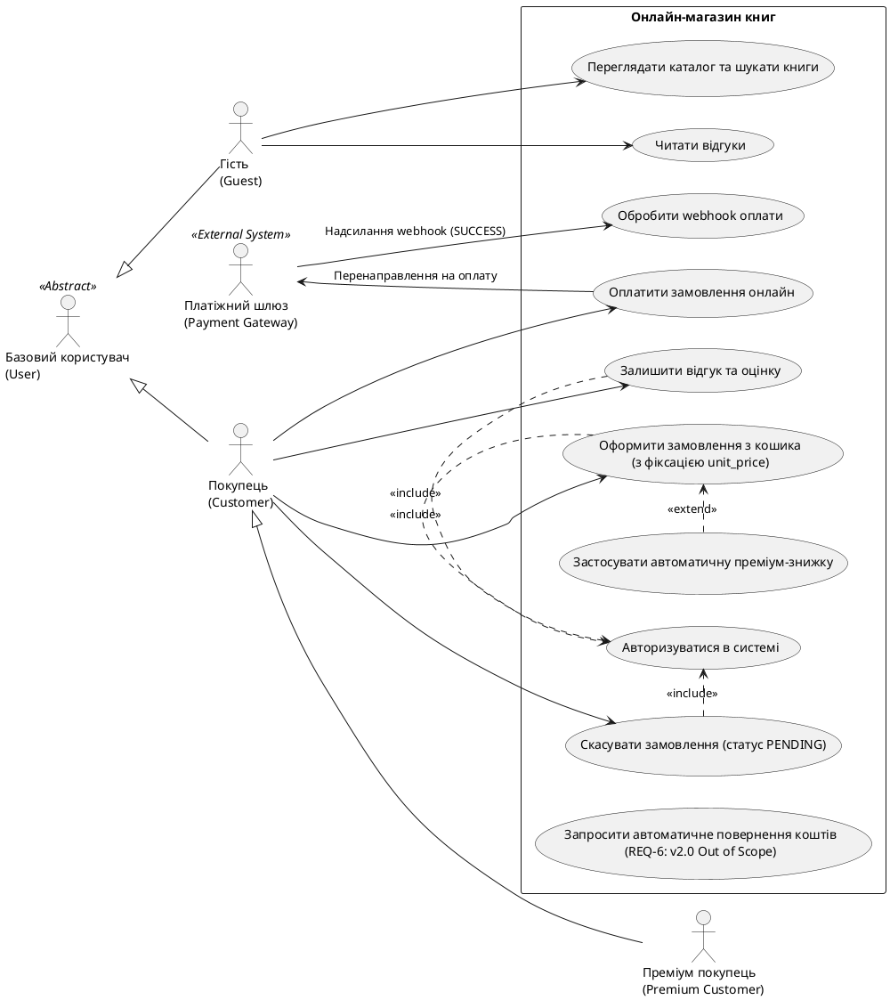

# Лог промптів: Генерація вимог та Use Case діаграми

## Промпт 1

**Запит:**
> Зроби ось це для проєкту "Онлайн-магазин книг" на основі написаного spec.md: таблицю трасування і код діаграми PlantUML
> 
> Специфікація вимог: Онлайн магазин книг
> 1. Актори та цілі
> User: Базовий користувач (авторизація, перегляд каталогу)
> Guest (успадковує User): Незареєстрований відвідувач. Переглядає каталог, шукає книжки, читає відгуки
> Customer (успадковує User): Звичайний покупець. Оформлює замовлення, оплачує онлайн, скасовує замовлення у PENDING та пише відгуки. Ціна книги для нього фіксується в unit_price (3NF)
> Premium Customer (успадковує Customer): Постійний покупець. Отримує автоматичну знижку при оформленні замовлення
> Payment Gateway: Зовнішній платіжний сервіс. Приймає оплату та надсилає webhook для зміни статусу замовлення на PAID
> 
> 2. EARS
> REQ-1 (Ubiquitous): Система SHALL вимагати авторизацію для дій, що змінюють стан (замовлення, скасування, відгуки)
> REQ-2 (Ubiquitous): Система SHALL фіксувати BOOK.price у ORDER_ITEM.unit_price при створенні замовлення
> REQ-3 (Event-driven): WHEN покупець підтверджує замовлення, система SHALL перенаправляти його на платіжний шлюз
> REQ-4 (Event-driven): WHEN від платіжки приходить успішний webhook, система SHALL змінювати ORDER.status на PAID
> REQ-5 (State-driven): WHILE замовлення в статусі PENDING, система SHALL дозволяти його скасування
> REQ-6 (Optional): WHERE покупець просить повернення коштів, система SHALL робити автоматичний refund (непокрита у v1.0)
> 
> 4. User Stories
> US-1: Як Customer, я хочу оформлювати замовлення з кошика, щоб придбати обрані книжки
> US-2: Як Customer / Premium Customer, я хочу оплачувати замовлення карткою онлайн, щоб не возитися з післяплатою
> US-3: Як Customer, я хочу скасовувати замовлення у статусі PENDING, якщо змінив плани або помилився
> US-4: Як Customer, я хочу залишати відгук та оцінку на придбану книгу, щоб поділитися враженнями
> 
> 5. Сценарії Gherkin
> Сценарій 1: Оформлення та оплата
> Scenario: Successful payment Given Покупець у системі та має книгу в кошику When Покупець підтверджує замовлення And Платіжка повертає "SUCCESS" Then система створює ORDER зі статусом "PAID" And зберігає unit_price для книги
> 
> Сценарій 2: Скасування замовлення
> Scenario: Cancel order Given замовлення має статус "PENDING" When Покупець натискає "Скасувати" Then статус змінюється на "CANCELLED"
> 
> Сценарій 3: Додавання відгуку
> Scenario: Leave review Given Покупець купив книгу When Покупець ставить оцінку 5 і пише коментар Then система зберігає відгук у REVIEW
> 
> 6. Критерії прийняття (Acceptance Criteria)
> Актори: На діаграмі присутні користувачі різного рівня (Guest, Customer, Premium Customer) та зовнішній сервіс Payment Gateway
> Зв'язки Use Case: Обов'язкова наявність залежностей include (для авторизації), extend (для преміум-знижки) та успадкування роли Premium Customer
> Матриця трасування: Наочне відображення зв'язків N:M (багато-до-багатьох) між функціональними EARS-вимогами та сценаріями використання
> Межі релізу: Наявність як мінімум однієї непокритої вимоги у v1.0 (REQ-6: автоматичний refund)
> Формат артефакту: Схема Use Case розробляється та зберігається у вигляді PlantUML-коду

---

### Відповідь ШІ 1

#### 1. Матриця трасування 

| ID вимоги (EARS) | Тип вимоги | Опис вимоги | Use Case (Сценарій використання) | User Story | Сценарій Gherkin | Межі релізу |
| :--- | :--- | :--- | :--- | :--- | :--- | :--- |
| **REQ-1** | Ubiquitous | Обов'язкова авторизація для дій, що змінюють стан системи | UC-4: Авторизуватися в системі | US-1, US-2, US-3, US-4 | Сценарій 1, 2, 3 | v1.0 (Включено) |
| **REQ-2** | Ubiquitous | Фіксація BOOK.price у ORDER_ITEM.unit_price при створенні замовлення | UC-5: Оформити замовлення з кошика | US-1 | Сценарій 1 | v1.0 (Включено) |
| **REQ-3** | Event-driven | Перенаправлення на платіжний шлюз при підтвердженні замовлення | UC-7: Оплатити замовлення онлайн | US-2 | Сценарій 1 | v1.0 (Включено) |
| **REQ-4** | Event-driven | Зміна статусу ORDER.status на PAID при отриманні успішного webhook | UC-8: Обробити webhook оплати | US-2 | Сценарій 1 | v1.0 (Включено) |
| **REQ-5** | State-driven | Дозвіл на скасування замовлення у статусі PENDING | UC-9: Скасувати замовлення у статусі PENDING | US-3 | Сценарій 2 | v1.0 (Включено) |
| **REQ-6** | Optional | Автоматичний refund (повернення коштів) за запитом покупця | UC-11: Запросити автоматичне повернення коштів | — | — | v2.0 (Out of Scope / Непокрита у v1.0) |

---

#### 2. PlantUML код діаграми 



## Промпт 2

**Запит:**
> Перероби це, бо вийшло занадто складно. Зроби таблицю трасування у вигляді нормальної компактної Markdown-таблиці з колонками Вимога ID, Опис, UC-1...UC-5 і Покриття. Прибери з таблиці колонки з User Story та Gherkin, вони тут зайві. Зроби людську нумерацію UC-1, UC-2, UC-3, UC-4, UC-5 замість випадкових. Зв'язки зроби чітко N:M, а REQ-6 залиш непокритою v1.0, як і було. У PlantUML коді прибери дублювання, зроби короткі назви usecase (UC-1...UC-5, UC-Auth, UC-Discount, REQ-6) і залиш тільки основні зв'язки: Guest до UC-1, Customer до UC-2..UC-5, Payment Gateway до UC-3, include для авторизації та extend для преміум-знижки

---

### Відповідь ШІ 2

#### 1. Таблиця трасування вимог (EARS ↔ Use Cases)

| Вимога ID | Опис вимоги | UC-1 | UC-2 | UC-3 | UC-4 | UC-5 | Покриття |
| :--- | :--- | :---: | :---: | :---: | :---: | :---: | :--- |
| **REQ-1** | Авторизація для дій, що змінюють стан | | ✕ | ✕ | ✕ | ✕ | v1.0 |
| **REQ-2** | Фіксація BOOK.price у ORDER_ITEM.unit_price | | ✕ | | | | v1.0 |
| **REQ-3** | Перенаправлення на платіжний шлюз | | ✕ | ✕ | | | v1.0 |
| **REQ-4** | Зміна статусу ORDER.status на PAID через webhook | | | ✕ | | | v1.0 |
| **REQ-5** | Скасування замовлення у статусі PENDING | | | | ✕ | | v1.0 |
| **REQ-6** | Автоматичний refund (повернення коштів) | | | | | | **v2.0 (Out of Scope)** |

---

#### 2. Код діаграми PlantUML (`use-case-diagram.puml`)

```plantuml
@startuml use-case-diagram
left to right direction

actor "User" as User << Abstract >>
actor "Guest" as Guest
actor "Customer" as Customer
actor "Premium Customer" as PremiumCustomer
actor "Payment Gateway" as PaymentGateway << External System >>

User <|-- Guest
User <|-- Customer
Customer <|-- PremiumCustomer

rectangle "Онлайн-магазин книг" {
    usecase "UC-1: Перегляд каталогу та відгуків" as UC1
    usecase "UC-2: Оформлення замовлення" as UC2
    usecase "UC-3: Оплата замовлення та webhook" as UC3
    usecase "UC-4: Скасування замовлення" as UC4
    usecase "UC-5: Залишення відгуку" as UC5
    usecase "UC-Auth: Авторизація" as UCAuth
    usecase "UC-Discount: Преміум-знижка" as UCDiscount
    usecase "REQ-6: Автоматичний refund (v2.0)" as REQ6
}

' Зв'язки акторів із Use Cases
Guest --> UC1
Customer --> UC2
Customer --> UC3
Customer --> UC4
Customer --> UC5

PaymentGateway --> UC3

' Залежності include / extend
UC2 .> UCAuth : <<include>>
UC3 .> UCAuth : <<include>>
UC4 .> UCAuth : <<include>>
UC5 .> UCAuth : <<include>>

UCDiscount .> UC2 : <<extend>>

note right of REQ6
  Непокрита вимога у v1.0
  Обробка вручну
end note

@enduml
